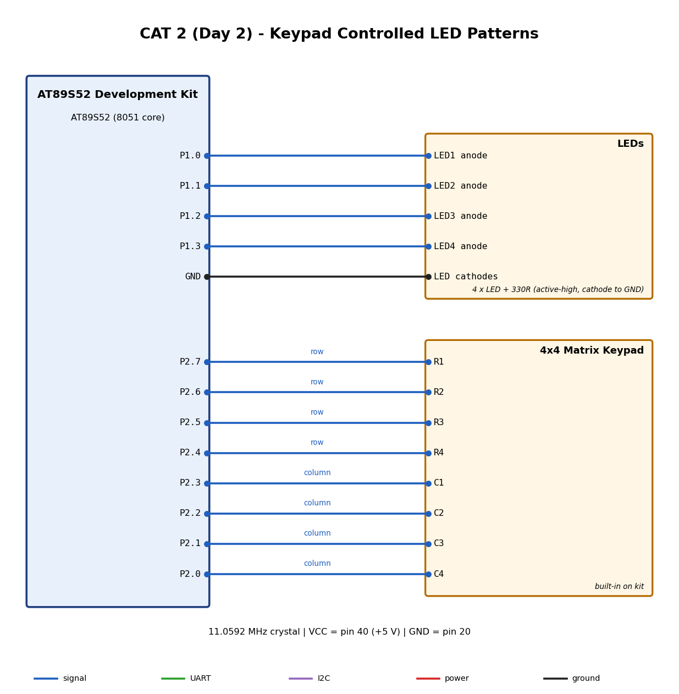

# EXPERIMENT DETAILS

**EXP:** CAT 2 (Day 2)

**DATE:** 20/07/2026

**NAME OF EXP:** Timer-Based LED Pattern Generator and Button Interrupt Controller (Day 2 keypad version)

**HARDWARE SETUP / PLATFORM:** AT89S52 development kit + Keil uVision (C51)

---

## TASK NO

> TODO: copy the task text from the questions PDF.

### 1. Circuit Diagram

### 2. Core Logic / Pseudocode / Code Base

Source and project files are in this folder. See the `.C` file for the implementation.

### 3. INFERENCE

> TODO: add your observations and conclusion.
