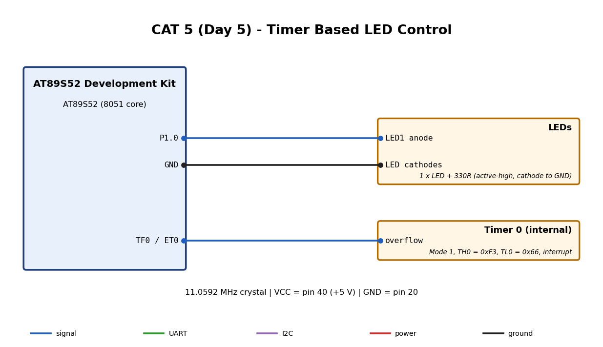

# EXPERIMENT DETAILS

**EXP:** CAT 5 (Day 5)

**DATE:** 10/08/2026

**NAME OF EXP:** Hardware Timer and Interrupt-Based Timing for LED Fading, Pulse Generation, and Stepper Motor Control

**HARDWARE SETUP / PLATFORM:** AT89S52 development kit + Keil uVision (C51)

---

## TASK NO

> TODO: copy the task text from the questions PDF.

### 1. Circuit Diagram

### 2. Core Logic / Pseudocode / Code Base

Source and project files are in this folder. See the `.C` file for the implementation.

### 3. INFERENCE

> TODO: add your observations and conclusion.
