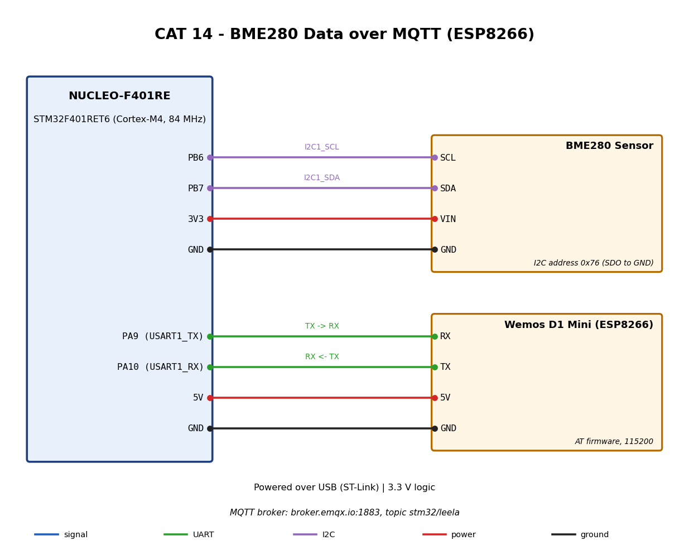

# EXPERIMENT DETAILS

**EXP:** CONTINUOUS ASSESSMENT 14

**DATE:** 12/11/2026

**NAME OF EXP:** BME280 Sensor Data Publishing over MQTT Using ESP8266, with a Node-RED comparison against OpenWeather (Chennai)

**HARDWARE SETUP / PLATFORM:** STM32CubeMX + Keil MDK + NUCLEO-F401RE (STM32F401RET6) + Bosch BME280 (I2C) + ESP8266 Wi-Fi module (USART1)

---

## TASK : Publish BME280 readings to an MQTT broker

### 1. Circuit Diagram

- **Development Board:** NUCLEO-F401RE
- **Microcontroller IC:** STM32F401RET6
- **I2C pins:** PB6 (I2C1_SCL), PB7 (I2C1_SDA) to the BME280
- **UART pins:** PA9 (USART1_TX), PA10 (USART1_RX) to the ESP8266
- **Power:** BME280 on 3.3 V, common GND

### 2. Core Logic / Pseudocode / Code Base

1. Initialise HAL, clock, GPIO, I2C1 and USART1.
2. `ESP8266_Init` in station mode, then `ESP8266_wifiConnect` (set your own SSID and password in `Core/Src/main.c`).
3. `ESP8266_portConnect("TCP", "broker.emqx.io", "1883")`, then `MQTT_connectBroker`.
4. Check the BME280 with `HAL_I2C_IsDeviceReady`, then configure it through the Bosch API.
5. Loop every 2 s: read temperature, pressure and humidity, format JSON and call `MQTT_publishTopic("stm32/leela", ...)` at QoS0. If a read fails, publish `{"status":"error","code":N}` instead of old values.

Source: `Core/Src/main.c`, `Core/Src/ESPLib.c`, `Core/Src/bme280.c`. Firmware: `Task14.hex`.

6. Node-RED Flow 2 receives the readings on `stm32/leela`. Flow 1 fetches Chennai weather from OpenWeather every 10 min and passes it to Flow 2 through a link node.
7. One function node in Flow 2 combines both sources and feeds the dashboard at `http://localhost:1880/dashboard/lab14`:
   - a table with BME280, Chennai and difference (BME280 minus Chennai) for temperature, humidity and pressure;
   - line charts for the last 1 hour and the last 12 hours, with one line per source.

Node-RED files (dashboard installer and flow export) are in [`../CAT`](../CAT/README.md).

### 3. OBSERVATION

| Quantity | BME280 (room) | Chennai (OpenWeather) | Difference |
|---|---|---|---|
| Temperature (°C) | 26.30 | 30.09 | -3.79 |
| Humidity (%) | 59.59 | 64 | -4.41 |
| Pressure (hPa) | 1010.98 | 1011 | -0.02 |

- Readings taken on 12/11/2026 (Chennai: haze).
- BME280 publishes every 2 s. The charts plot one point per minute.
- Chennai pressure is sea-level pressure, so the pressure difference is only a rough comparison.

### 4. INFERENCE

- The STM32 reads the BME280 over I2C and publishes JSON over MQTT through the ESP8266, and Node-RED receives it in real time.
- Comparing the sensor with the OpenWeather data shows how the room differs from outdoor conditions. For example, a lower room temperature and humidity shows the effect of AC or ventilation.
- Indoor and outdoor pressure stay close, because both are at almost the same altitude.
- Combining a local sensor with a cloud API gives more meaning than either source alone. For example, it can decide whether opening a window or watering plants is needed.

### 5. PLANT WATERING DECISION (shown in Node-RED; pump hardware not implemented yet)

The dashboard shows how much to water the plants, computed from the live BME280 humidity. Dry air dries the soil faster, so lower humidity means more water.

| BME280 humidity | Output |
|---|---|
| above 70 % | NO WATER: air is moist |
| 65 to 70 % | LITTLE WATER |
| below 65 % | MORE WATER: air is dry |

The decision uses only the real BME280 reading and updates with every MQTT message (about every 3 s).

Live result on 12/11/2026: BME280 humidity 59.59 % gives **MORE WATER: humidity 59.6 % is below 65 %, air is dry**.

Notes for later:
- The BME280 measures air, not soil. A soil moisture sensor on an ADC pin would give a more direct reading.
- To drive a pump: publish the level to a new MQTT topic, for example `stm32/leela/water`. The STM32 subscribes and switches a relay or MOSFET for the pump.
- Add a small hysteresis (about 1 %) so the output does not jump between levels near 65 % and 70 %.
