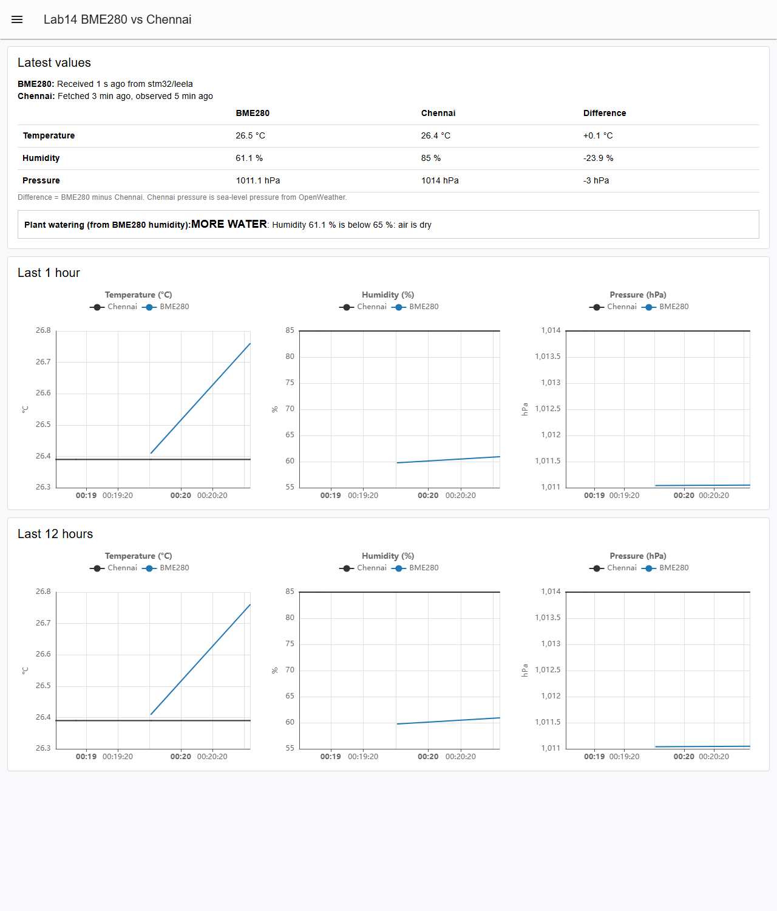

# EXPERIMENT DETAILS

**EXP:** CONTINUOUS ASSESSMENT 15 (Project: Node-RED part of CAT14)

**DATE:** 12/11/2026

**NAME OF EXP:** Node-RED Dashboard Comparing BME280 MQTT Data with OpenWeather (Chennai) and Deciding Plant Watering

**HARDWARE SETUP / PLATFORM:** Node-RED + @flowfuse/node-red-dashboard 1.33 + MQTT broker (broker.emqx.io) + OpenWeather Current Weather API. The firmware that publishes the BME280 data is in [`../CAT14`](../CAT14/README.md).

---

## Files

| File | Purpose |
|---|---|
| `lab14-flows.json` | Export of Node-RED Flow 1 (OpenWeather) and Flow 2 (MQTT + dashboard), with the dashboard page, groups and MQTT broker config. Import it with Menu → Import. |
| `lab14-dashboard.cjs` | Installer script. It adds the Lab14 nodes to a running Node-RED that already has the original Flow 1 and Flow 2. Safe to run again. |

### 1. Flow Overview

- **Flow 1:** the inject "Refresh Chennai every 10 min" calls the http request node for `https://api.openweathermap.org/data/2.5/weather?q=Chennai&units=metric`. The link out "Weather to Flow 2" passes the result on.
- **Flow 2:** the mqtt in node subscribes to `stm32/leela` and receives `{"status":"success","temperature":..,"humidity":..,"pressure":..}` from the STM32 about every 3 s. The link in "Weather from Flow 1" brings in the weather.
- **Function "Combine BME280 + Chennai":** keeps the latest reading from each source and sends:
  - the comparison table (BME280, Chennai, difference);
  - chart points for temperature, humidity and pressure (BME280 at most one point per minute);
  - the plant watering decision.
- **Dashboard** at `http://localhost:1880/dashboard/lab14`: table, watering box, and line charts for the last 1 hour and last 12 hours.

### 2. Plant Watering Logic

Based only on the real BME280 humidity. Dry air dries the soil faster.

| BME280 humidity | Output |
|---|---|
| above 70 % | NO WATER: air is moist |
| 65 to 70 % | LITTLE WATER |
| below 65 % | MORE WATER: air is dry |

### 3. How to Run

1. Start Node-RED: `node-red`.
2. Either import `lab14-flows.json` and click Deploy, or, with the original Flow 1 and Flow 2 already deployed, run:
   ```bash
   node lab14-dashboard.cjs
   ```
3. Power the STM32 board running the CAT14 firmware.
4. Open `http://localhost:1880/dashboard`. The Lab14 page opens first.

### 4. Dashboard Output



Screenshot taken on 14/11/2026. The board was not powered at that time, so the BME280 values come from mock MQTT messages in the same JSON format, published to `stm32/leela` near the earlier real readings. The Chennai values are live from OpenWeather.

### 5. OBSERVATION

| Quantity | BME280 (room) | Chennai (OpenWeather) | Difference |
|---|---|---|---|
| Temperature (°C) | 26.30 | 30.09 | -3.79 |
| Humidity (%) | 59.59 | 64 | -4.41 |
| Pressure (hPa) | 1010.98 | 1011 | -0.02 |

Watering output for this reading: **MORE WATER** (humidity 59.6 % is below 65 %).

### 6. INFERENCE

- Node-RED joins live sensor data (MQTT) and cloud data (HTTP API) in one function node and shows them side by side.
- The room was cooler and drier than outdoor Chennai, while pressure matched closely.
- A simple humidity rule turns the sensor reading into an action (how much to water). A soil moisture sensor would make this more accurate, because the BME280 measures air, not soil.
